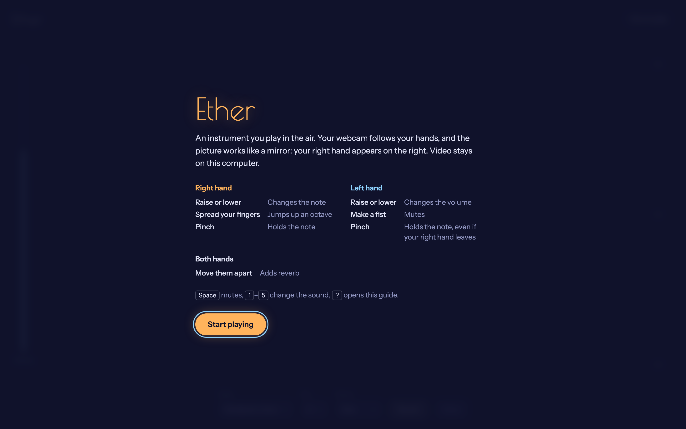
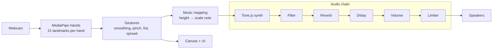

# Ether

**A musical instrument you play in the air.** Raise your hand and a note climbs. Lower the other and the sound fades. Spread your fingers to jump an octave, pinch to hold a note, close your fist to go silent.

Ether runs entirely in the browser. It tracks both hands through your webcam with MediaPipe and turns what they do into sound with Tone.js. Nothing to install, no backend, and the video never leaves your computer.

### [▶ Play it live](https://jonathanscontreras.github.io/ether/)



> In the early 1920s, Leon Theremin built the etherphone, an instrument played without touch. A century later, a webcam is enough.

---

## How to play

Open the link, click **Start playing** and allow the camera. The picture is a mirror, so your right hand shows on the right.

| Hand | Gesture | What it does |
|---|---|---|
| Right | Raise or lower | Changes the note |
| Right | Spread your fingers | Jumps up an octave |
| Either | Pinch thumb and index | Holds the note (a left-hand pinch keeps it going after your right hand leaves) |
| Left | Raise or lower | Changes the volume |
| Left | Make a fist | Mutes instantly |
| Both | Move them apart | Adds reverb |

Keyboard: <kbd>Space</kbd> mutes, <kbd>1</kbd>–<kbd>5</kbd> switch between sine, triangle, saw, square and pad, <kbd>?</kbd> opens the guide.

The bottom bar changes the scale (pentatonic minor/major, natural minor, major, chromatic), the key (A–G), the sound, and turns reverb on or off.

## Features

- **Two-handed control.** Up to two hands tracked at once with 21 landmarks each, at webcam frame rate.
- **Always in tune.** Pitch snaps to the selected scale, so it sounds like music instead of a siren. The default, A minor pentatonic, has no wrong notes.
- **Gestures that hold up.** Pinch, fist and finger-spread detection work at any distance from the camera and don't flicker at the edges.
- **Five sounds.** Sine, triangle, saw, square, and a detuned, filtered pad with a slow swell.
- **Effects you play with your body.** Reverb and delay, with the reverb amount set by how far apart your hands are.
- **Visual feedback.** Glowing hand skeletons color-coded by role, a large note name that brightens with volume, a note ladder and volume meter lined up with where your hands need to be.
- **Private by design.** Hand tracking runs on-device in WebAssembly. No video or audio is uploaded anywhere.

## How it works



Each frame, MediaPipe returns landmark positions for every hand it sees. Ether smooths them, detects gestures, maps them to musical values, updates the synth, and redraws the canvas.

### Engineering notes

A few problems that took more than the obvious solution:

- **Mapping height to a scale, not a frequency.** Raw hand height mapped to frequency sounds chaotic. Ether divides the playable band into the notes of the current scale (two octaves), so every position lands on a note in key. Changing the scale or key rebuilds that list on the fly.
- **Hysteresis everywhere.** A hand resting on the line between two notes would flip between them every frame. The note only changes once the hand moves well past the boundary. Pinch and finger spread use the same idea, with separate on and off thresholds.
- **Gestures that don't depend on distance.** A pinch looks smaller in pixels when your hand is far from the camera. Every gesture compares fingertip distances to the length of the palm instead of using fixed pixel thresholds, so they behave the same up close or across the room.
- **Jitter vs. latency.** Landmark positions are averaged over the last 5 frames (about 170 ms), with short pitch glides between notes. That removes the tremor without making the instrument feel slow to respond.
- **Where volume sits in the chain.** Volume comes after the reverb and delay, not before. Otherwise a fist would cut the synth but leave several seconds of reverb tail ringing. A limiter at the end keeps loud moments from clipping.
- **Handedness in a mirror.** MediaPipe labels hands assuming a mirrored selfie image. Ether feeds it the raw camera frame for accuracy, swaps the labels back, and mirrors only the display.
- **Audio autoplay rules.** Browsers block sound until the user interacts with the page, so the "how to play" screen doubles as the click that starts audio and the camera.

## Tech stack

| Layer | Tool |
|---|---|
| Hand tracking | [MediaPipe Hands](https://developers.google.com/mediapipe/solutions/vision/hand_landmarker) (WebAssembly, on-device) |
| Audio | [Tone.js](https://tonejs.github.io/) (Web Audio API) |
| Rendering | HTML5 Canvas |
| UI | Vanilla HTML, CSS and JavaScript, no framework or build step |
| Hosting | GitHub Pages |

## Run it locally

The camera only works on `localhost` or HTTPS, so serve the folder rather than opening the file directly:

```bash
git clone https://github.com/JonathanSContreras/ether.git
cd ether
python3 -m http.server 8000
```

Then open <http://localhost:8000>. Requires a webcam and a desktop browser (Chrome, Firefox or Safari).

## Project structure

```
ether/
├── index.html   # Page structure, controls and the how-to-play guide
├── style.css    # Visual design (color tokens, layout, responsive rules)
├── app.js       # Hand tracking, gesture detection, audio engine, drawing and UI wiring
└── docs/        # README images
```

`app.js` is split into labeled sections (music settings, audio, gestures, smoothing, layout, drawing, display, tracking, controls) and has no dependencies beyond the two CDN libraries.

## What's next

- **Chord mode:** each hand plays its own note, for intervals and harmony
- **Loop recorder:** pinch and hold to record a phrase, release to loop it
- **Brightness on the left hand:** open the pad's filter as the volume rises
- **Visualizer mode:** an audio-reactive particle field in place of the hand skeleton
- **Presets:** save and load sound and scale combinations
- **Duet mode:** two players over WebRTC

## Build log

Ether was built in a week, one layer per day:

1. Hand tracking and the landmark skeleton
2. First sound: a synth following the right hand
3. Scale quantization, left-hand volume, octave on finger spread
4. Pinch to hold, fist to mute, jitter smoothing
5. Reverb, delay, limiter, and hands-apart reverb control
6. Visual design, controls, and the how-to-play guide
7. Shipped

## Credits

Inspired by Leon Theremin's etherphone (1920), Google's browser body-synth experiments, and HandsFree.js.

## License

[MIT](LICENSE)
